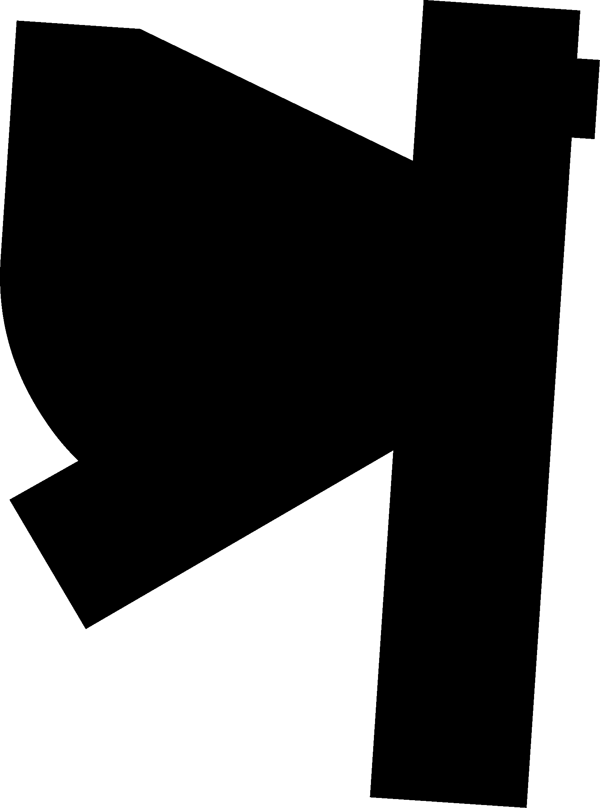

---
hide:
  - toc
---

  

    Niazs study Journal
    <h1>Study louder.</h1>
    
Everything for your courses, sorted by semester and the way you’re assessed. Find your notes, prep for the next test, and keep moving.

    

      <a class="p-button" href="semester-04/">Explore semester 4 ↗</a>
      <a class="p-button p-button--secondary" href="#all-semesters">Browse all semesters ↓</a>
    

  

  

  04 semesters
  13 courses
  05 assessment sections / course

  <h2>Pick a semester</h2>
  01 — 04

  <a class="p-card" href="semester-01/">
    01 / Foundation
    Semester 1
    BUS101 · ENG7101 · MAT101 · STA191 ↗
  </a>
  <a class="p-card" href="semester-02/">
    02 / Building up
    Semester 2
    CS191 · MAT102 · PHY100 ↗
  </a>
  <a class="p-card" href="semester-03/">
    03 / Going deeper
    Semester 3
    DSA101 · ENG7102 · MAT291 ↗
  </a>
  <a class="p-card p-card--current" href="semester-04/">
    04 / Current semester
    Semester 4
    PPHS 7102 · CS295 · STA293 ↗
  </a>

  <strong>Start where you are.</strong> Semester 4 is the current workspace. Earlier semesters are ready for notes and resources as you add them.

  

    STA293 / Probability lab
    <h2>Flip a coin. Watch the math.</h2>
    
Try the interactive Coin Toss Lab to explore Bernoulli trials, binomial distributions, and live results.

  

  <a class="p-button" href="coin-toss/">Open Coin Toss Lab ↗</a>

